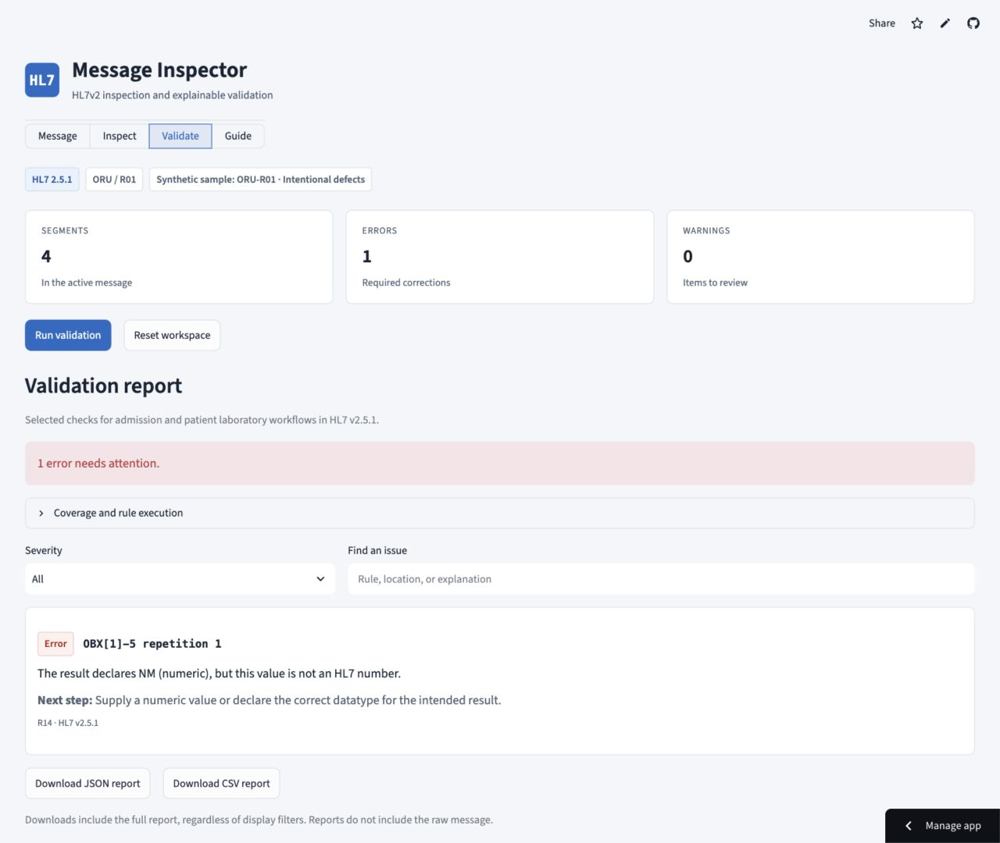

# HL7v2 Inspector and Validator

A focused tool for healthcare integration engineers, interface analysts, and learners practicing HL7v2 troubleshooting. Paste or upload a message, inspect its structure, and read validation issues with locations and practical next steps.

Try the [live app](https://hl7v2-inspector-validator.streamlit.app/).

The inspector preserves raw field positions alongside hl7apy parsing. The validator checks three bounded HL7 v2.5.1 profiles and exports structured reports as JSON or CSV.



## Run locally

Use Python 3.12. From this repository folder:

```sh
python -m venv .venv
source .venv/bin/activate
python -m pip install -r requirements.txt
streamlit run app.py
```

On Windows, activate with `.venv\Scripts\activate`. Runtime dependencies are pinned to Streamlit 1.65.0 and hl7apy 1.3.5. No API key, database, paid account, or clinical connection is needed.

## Supported profiles

| Profile | Scenario | Core segment sequence |
| --- | --- | --- |
| ADT-A01 | Admission | MSH, EVN, PID, PV1 |
| ORM-O01 | Patient laboratory order | MSH, PID, ORC, OBR |
| ORU-R01 | Patient laboratory result | MSH, PID, OBR, OBX |

These are selected checks for specific admission and laboratory scenarios, not complete message specifications. Repeated order and observation groups are supported. Laboratory requirements are not universal ORM or ORU requirements. Other versions and message types remain inspectable where possible, with explicit validation coverage notices.

## Synthetic sample library

All six bundled messages are **synthetic**. There are no real patient records.

| Sample | Intended behavior |
| --- | --- |
| ADT admission baseline | Populated patient identifiers, name, event time, and visit |
| ADT with defects | Missing PID-3 and an impossible event date |
| ORM laboratory order baseline | Patient and order identifiers in the expected sequence |
| ORM with defects | OBR placed before its ORC order-control segment |
| ORU laboratory result baseline | Numeric and text observations |
| ORU with defects | Text supplied for a numeric observation |

The [sample manifest](samples/manifest.json) declares the expected rule outcomes. Load a sample from the Message view or upload one UTF-8 ER7 file. Editing the input invalidates the previous validation report. Reset clears the active workspace.

## Rule coverage

Fifteen rule families cover the following checks:

| Rules | Coverage |
| --- | --- |
| R01-R06 | Header placement, delimiters, message identity, version, and processing metadata |
| R07-R08 | Required core segments and segment-group order |
| R09-R11 | Required field values, patient identifiers, and names |
| R12 | Selected date and time fields |
| R13 | Laboratory order identifiers |
| R14-R15 | Observation datatype/value consistency and result status |

[Rule definitions and sources](docs/rules.md) distinguish standard-derived checks, profile requirements, and advisory warnings. Datatype checks cover selected NM, ST, TX, CE, and CWE observations. Date/time checks accept reduced precision, fractional seconds, and numeric timezones.

Inspection uses hl7apy's tolerant parser without group construction, plus a delimiter-aware raw view preserving empty, explicit-null, repeated, and trailing fields. Field names and datatypes come from hl7apy's version definitions. The raw view remains available after recoverable parsing failures. Parsing success is separate from validation success.

## Tests and evaluation

```sh
python -m pip install -r requirements-dev.txt
pytest -q
ruff check .
ruff format --check .
mypy parser.py validator.py app.py ui.py
python scripts/evaluate.py
```

The suite contains 71 tests, including four Streamlit AppTest workflows. The expected-versus-observed benchmark contains 24 authored cases: three baselines, one defect per rule family, and six legitimate edge cases. Expectations are specified separately from validator output. All 24 cases matched their expectations in the recorded run.

The [evaluation](docs/evaluation.md), [observed results](docs/benchmark_results.json), and [case definitions](tests/cases.py) make the evidence reproducible. These results describe controlled synthetic inputs; they do not establish accuracy on hospital traffic or learning gains.

## Limitations and data handling

The tool does not certify full HL7 conformance, interpret clinical results, validate terminology membership, or replace a receiving system's specification. Validation covers selected HL7 v2.5.1 checks for the profiles above. Unsupported elements receive coverage notices; a clean limited report is not presented as a pass.

Input limits are 5 MB, 1,000 segments, and 20,000 separator characters. One unframed ER7 message is accepted at a time. Batch and MLLP framing are unsupported. Escapes remain encoded, and validation does not inspect every HL7 field.

Use synthetic or de-identified data. Streamlit processes input on its server. The application holds it in the active session and does not deliberately persist or log messages or use a shared message cache. Reset clears the active workspace and report. Reports omit the raw message; locations and coverage notes still describe the input, so review exports before sharing. Hosting providers have their own infrastructure and retention policies.

## Repository structure

```text
app.py                  Streamlit session and navigation
parser.py               hl7apy integration and preserved raw inspection
validator.py            Profiles, rules, and report serialization
ui.py / styles.css      Presentation helpers and visual styling
samples/                Six synthetic fixtures and expected outcomes
tests/                  Parser, validator, and Streamlit workflow checks
scripts/evaluate.py     Reproducible benchmark runner
docs/                   Rule sources and evaluation evidence
assets/                 SVG brand mark and README screenshot
```

## Deployment

Deploy the `main` branch and `app.py` using [Streamlit Community Cloud](https://share.streamlit.io/). Select Python 3.12 in advanced settings. `requirements.txt` contains the runtime dependencies; development requirements are not needed on the server. No secrets are required. [Official deployment instructions](https://docs.streamlit.io/deploy/streamlit-community-cloud/deploy-your-app/deploy) describe the account and GitHub connection steps. The public deployment was verified on October 9, 2026 using synthetic inputs, including uploads, inspection, validation, and JSON/CSV downloads.
