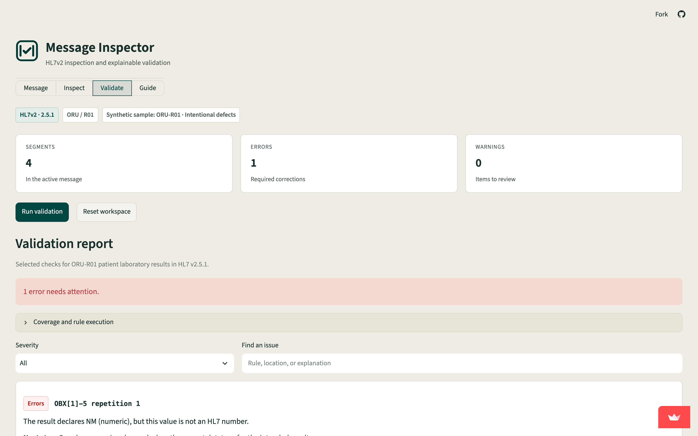

# HL7v2 Message Inspector and Validator

Inspect HL7v2 messages and diagnose interface defects with field-level explanations.

**[Live Demo](https://hl7v2-inspector-validator.streamlit.app/)**

An HL7v2 message can parse successfully and still fail in a receiving system. A missing patient identifier, an impossible timestamp, a numeric result containing text, or misplaced order segments can interrupt an interface workflow. This project makes those defects visible and explains what to check next.

Built for healthcare integration engineers, interface analysts, and learners practicing interoperability troubleshooting. The repository includes runnable source, documented rules, synthetic examples, and reproducible evaluation evidence.

<p align="center">
  
</p>

## Sample output

Test-run excerpt from `python -m pytest -q` using Python 3.11.

```text
73 passed in 2.24s
```

## What it does

- **Message:** paste one message, upload a UTF-8 .hl7 or .txt file, or load a synthetic sample.
- **Inspect:** examine the field table and expandable segment, field, repetition, component, and subcomponent hierarchy. Raw positions, empty fields, and explicit-null values are preserved.
- **Validate:** run 15 rule families covering selected header, patient, timestamp, order, and observation checks. Issues include severity, location, explanation, and a suggested next step.
- **Guide:** read plain-language explanations of common interface defects and profile requirements.
- **Reports:** download the complete validation report as JSON or CSV without the raw message. Display filters do not remove issues from exports.

Editing the message invalidates its previous report. Reset workspace clears input and results.

## Supported profiles

Validation covers three bounded HL7 v2.5.1 profiles:

| Profile | Workflow | Required core sequence |
| --- | --- | --- |
| ADT-A01 | Admission | MSH, EVN, PID, PV1 |
| ORM-O01 | Patient laboratory order | MSH, PID, ORC, OBR |
| ORU-R01 | Patient laboratory result | MSH, PID, OBR, OBX |

Repeated laboratory order and observation groups are supported. These laboratory requirements are project profile decisions, not universal ORM or ORU requirements. The [rule definitions](docs/rules.md) distinguish standard-derived checks, profile requirements, and advisory warnings.

## Validation results

| Check | Recorded result |
| --- | --- |
| Expected-versus-observed benchmark | **24 of 24 cases matched** |
| Automated tests | **73 passing**, including five Streamlit AppTest workflows |
| Ruff lint and formatting | Clean |
| mypy | Clean for parser.py, validator.py, app.py, and ui.py |

The benchmark contains three baselines, 15 defect cases, and six legitimate edge cases. Expectations are specified separately from validator output. Defect cases check rule sets, principal locations, and severity; clean cases require complete coverage and no issues.

Read the [evaluation](docs/evaluation.md), inspect the [recorded results](docs/benchmark_results.json), or review the [case definitions](tests/cases.py). These results describe controlled synthetic inputs and do not establish accuracy across hospital traffic or learning gains.

## Tech stack

Python 3.12, Streamlit, hl7apy, and pytest. Ruff and mypy provide linting, formatting, and type checks. Runtime dependencies are pinned to Streamlit 1.65.0 and hl7apy 1.3.5.

The parser combines hl7apy's tolerant parsing with a delimiter-aware raw view. Parsing, validation rules, and presentation are separated so that message behavior can be tested independently of the interface. No database, API key, paid account, or clinical connection is required.

## Quickstart

From this repository folder, using Python 3.12:

```sh
python -m venv .venv
source .venv/bin/activate
python -m pip install -r requirements.txt
streamlit run app.py
```

On Windows, activate with `.venv\Scripts\activate`.

To run the checks and benchmark:

```sh
python -m pip install -r requirements-dev.txt
pytest -q
ruff check .
ruff format --check .
mypy parser.py validator.py app.py ui.py
python scripts/evaluate.py
```

## Synthetic data

**All bundled messages and benchmark inputs are synthetic. No patient data or employer interface logs are included.**

The six-message library contains a baseline and an intentionally broken example for each profile. The broken ADT demonstrates a missing identifier and impossible date; the broken ORM demonstrates invalid order grouping; the broken ORU supplies text for a numeric observation. The [sample manifest](samples/manifest.json) declares the expected rule outcomes.

## Scope and limitations

This is a troubleshooting and portfolio tool. It does not certify full HL7 conformance, interpret clinical results, validate terminology membership, or replace a receiving system's specification.

- Input is limited to one unframed ER7 message within 5 MB, 1,000 segments, and 20,000 separator characters. Batch and MLLP framing are unsupported.
- Selected NM, ST, TX, CE, and CWE values are checked. Other versions, message types, additional segments, and unimplemented datatypes receive explicit coverage notices where inspection is possible.
- Date/time validation covers documented fields and permits legitimate reduced precision. Escapes remain encoded, and not every HL7 field is validated.
- A clean report means only that the implemented checks found no issues within their stated coverage. The small authored benchmark benefits from independent review and unseen test messages.
- This application processes HL7v2 messages. It does not implement a FHIR API or an interface transport engine.

Use synthetic or de-identified input. Streamlit processes it on its server; the application holds it in the active session and does not deliberately persist or log messages or use a shared message cache. Reports omit the raw message, but locations and coverage notes can describe input. Review exports before sharing. Hosting providers have their own infrastructure and retention policies.

## Repository structure

```text
app.py                  Streamlit session and navigation
parser.py               hl7apy integration and raw inspection
validator.py            Profiles, rules, and report serialization
ui.py / styles.css      Presentation helpers and styling
samples/                Six synthetic messages and manifest
tests/                  Parser, validator, and UI workflow tests
scripts/evaluate.py     Reproducible benchmark runner
docs/                   Rule definitions and evaluation evidence
assets/                 Brand mark and workspace screenshot
```

## Deployment

Deploy the main branch and app.py using [Streamlit Community Cloud](https://share.streamlit.io/). Select Python 3.12 in advanced settings and install requirements.txt. No secrets are required. See the [official deployment instructions](https://docs.streamlit.io/deploy/streamlit-community-cloud/deploy-your-app/deploy).

**Author:** [Naveen Madhav](https://www.linkedin.com/in/naveenmadhav/)

This project is [MIT licensed](LICENSE).

**AI assistance:** I defined the project concept, requirements, and validation rule priorities based on my healthcare integration experience. AI coding assistants helped with planning, design exploration, implementation, debugging, testing, and documentation. I take responsibility for reviewing the project, checking its claims, and deciding what to submit.
